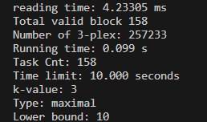
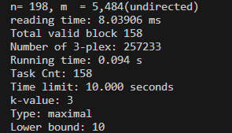
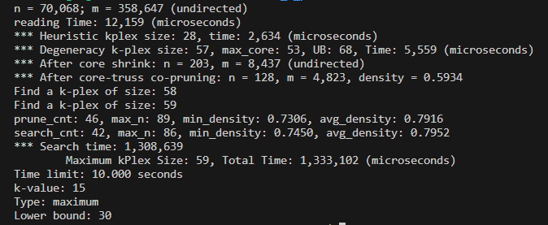
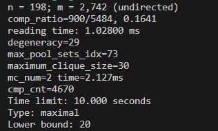
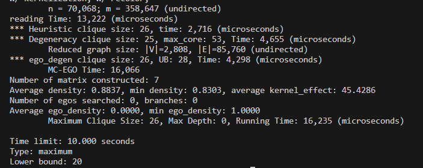

# MKP: Maximal K-plex Computation

This repository implements maximal k-plex computation algorithms which can also computes maximum k-plex, and when k is equal to exact 1, the k-plex is the clique.
## Compile the code

```sh
$ make clean
```
if your CPU architecture is arm:

```sh
$ make target=arm
```

if your CPU architecture is x86

```sh
$ make target=x86
```

It generates an executable "MKP".

## Run the code

1. File transformation.

   We supports two types of graph files.

   a. SNAP graph format, characterized by suffix ".txt". More files can be found at https://snap.stanford.edu/snap/

   b. DIMACS graph format, characterized by suffix ".clq". More files can be found at  http://cedric.cnam.fr/~porumbed/graphs/

   Before the use of our algorithm, we suggest to transform the graph into binary format, which minimize the time of reading input files.

   Example. Transform jazz.txt to a binary file 

   ./MKP  -b -f data/jazz.txt 

   This will generate a file named jazz.bin in the same fold as the text file.

   

2. Listing maximal k-plexes.

   Example. Suppose we want to list maximal 3-plexes of size at least 10 from jazz.**bin** . 

```sh
$ ./MKP -f ./data/jazz.bin -m "maximal" -k 3 -l 10 -t 10
```
In the above command,  "-m maximal" means that we want to list maximal graphs.  "-k 3" means k is assigned as 3. "-t 10" means the cutoff time is 10 seconds. "-l 10" means that we are only interested in k-plexes of size at least 10.

Then we get the following result.



the time of reading the input file is 4.23305 ms，and the time of listing maximal 3-plexes whose size is at least 10 is 0.099s  while the cutoff time is 10 seconds. 

​	Example. Suppose we want to list maximal 3-plexes of size at least 10 from jazz.**txt** . 

```sh
$ ./MKP -f ./data/jazz.txt -m "maximal" -k 3 -l 10 -t 10
```

we change the input file jazz.bin to jazz.txt. 

Then we get the following result.



the time of reading the input file is 8.03906 ms，and the time of listing maximal 3-plexes whose size is at least 10 is 0.094s  while the cutoff time is 10 seconds. 

obviously, using the graph of binary format can minimize the time of reading input files.

Notice: [Wang et al., 2022. Listing maximal k-plexes in large real-world graphs.]

3. Finding maximum k-plex 

   Example. Suppose we want to find the maximum 15-plex of size at least 30 from soc-slashdot.bin . 

   ```sh
   $ ./MKP -f data/soc-slashdot.bin -m "maximum" -k 15 -l 30 -t 10
   ```

   In the above command,  "-m maximum" means that we want to find the maximum k-plex.  "-k 15" means k is assigned as 3. "-t 10" means the cutoff time is 10 seconds. "-l 30" means that we are only interested in k-plexes of size at least 30.

   Then we get the following result.

   

   the time of reading the input file is 12.159 ms, and the time of finding the maximum 15-plex whose size is at least 30 is 1.333102 s  while the cutoff time is 10 seconds.

   Notice: [Wang et al., 2023. A Fast Maximum k-Plex Algorithm Parameterized by the Degeneracy Gap.]

4. Listing maximal clique (optional)

   Example. Suppose we want to list all the maximal cliques (i.e., 1-plexes) of size at least 10 from jazz.bin . 

   ```sh
   $  ./MKP -f data/jazz.bin -m "maximal" -l 20 -t 10
   ```

   In the above command,  "-m maximal" means that we want to list maximal graphs.  without option "-k" means we are intersted in cliques(i.e., 1-plexes) instead of k-plexes whose k is larger than 1. "-t 10" means the cutoff time is 10 seconds. "-l 20" means that we are only interested in cliques of size at least 20.

   Then we get the following result.

   

   


the time of reading the input file is 1.028 ms, and the time of listing maximal cliques whose size is at least 20  is 2.127 ms  while the cutoff time is 10 seconds.

​	Notice: [S. Han et al., 2018. Speeding Up Set Intersections in Graph Algorithms using SIMD Instructions]

5. Find maximum clique

Example. Suppose we want to find the maximum clique (i.e., 1-plexes) of size at least 20 from soc-slashdot.bin . 

```sh
$ ./MKP -f data/soc-slashdot.bin -m "maximum" -l 20 -t 10
```

In the above command,  "-m maximum" means that we want to find the maximum clique. without option "-k" means we are intersted in cliques(i.e., 1-plexes) instead of k-plexes whose k is larger than 1. "-t 10" means the cutoff time is 10 seconds. "-l 20" means that we are only interested in clique of size at least 20.

Then we get the following result.



the time of reading the input file is 0.13222 ms, and the time of finding the maximum clique whose size is at least 20 is 0.16235 ms  while the cutoff time is 10 seconds.	

Notice:[Chang et al., 2022. Efficient Maximum Clique Computation over Large Sparse Graphs]


## Options

The most important command line options are:

    -f Path to the input file graph
    -b Convert a text file to a binary file, no argument
    -t time limit, seconds
    -k k-value,default 1
    -m if need to find Maximum, argument is "maximum", and if need to enumerate maximal, argument is "maximal"
    -l lower bound, if type is Maximum, default 2k, and can not lower than default
                    if type is Maximal, default 0, and can not lower than default
    -h help, list all options
The common format of options are as follows.

```sh
$ ./MKP -f {file_path} -m "maximal" -b -k {k-value} -t {time_limit} -l {lower_bound}
```

## Enumeration storage and parameter validation

Maximal k-plex storage grows with actual graph and block sizes. Graph views share buffer ownership. The default minimum size is `2*k-1`; an explicitly smaller `-l` is rejected with exit status 2. `-k` must be positive, `-l` nonnegative, and integer parameters must not exceed `INT_MAX/4`. `-t` must be finite and within `[0,86400]`. Malformed values are rejected. Enumeration counts use an unsigned 64-bit counter. Search, branching and pruning rules remain unchanged.

Long tests and benchmarks follow the parent project `AGENTS.md` and `config.md` and run on the configured Ubuntu host.

## Parallel algorithm development and test tiers

Future work keeps the hardened serial reference immutable while allowing parallel-motivated local implementation and algorithm changes in candidate branches, preserving the enumeration problem and correct result sets. Read [the development policy](docs/parallel-development.md) and [repository instructions](AGENTS.md). The [test suite manifest](tests/test-suites.json) separates local development smoke checks, remote correctness regression, intermediate checks, and paper-audited challenging performance cases. The immutable one-thread reference is pinned in [the baseline manifest](tests/baselines/listplex-hardened-2026-10-25.json). This manifest is a declarative plan; historical benchmark runners do not automatically consume it.

New candidates use the native scheduler from [the selected ParlayLib fork](https://github.com/joey001/parlaylib.git), with `PARLAY_NUM_THREADS` controlling workers. [GBBS](https://github.com/ParAlg/gbbs) is an optional reference. Read the English [technique ledger](technique.md) and [runtime contract](tests/runtime-policy.json): one branch per technique, complete work/span accounting, few universal defaults, and broad serial/parallel non-regression before accepting a small-and-sweet technique. Historical OpenMP build instructions apply to the archived implementation, not the new candidate runtime.

Candidate techniques may adapt pivots, branches, pruning or partitioning when needed for parallelism; document the reason, correctness argument, comparable work/span bounds and experimental effects in the mainline technique ledger. The small-and-sweet and broad non-regression gates continue to apply.

## Ubuntu development workspace

The primary project root is `/home/joey/k-plex-rethinki-ubuntu`; this Git repository is its `relaxclq/` child. When developing there, the development host and test host are the same machine: compile and run all test tiers directly, using local tmux for long jobs. Do not SSH to the same server again. Resolve paths and budgets with `python3 ../tools/project-context.py --operation inventory`; see the parent `config.md` and `execution-environments.json`. Historical `remote` suite names refer to the Ubuntu test host, not a required network hop.
